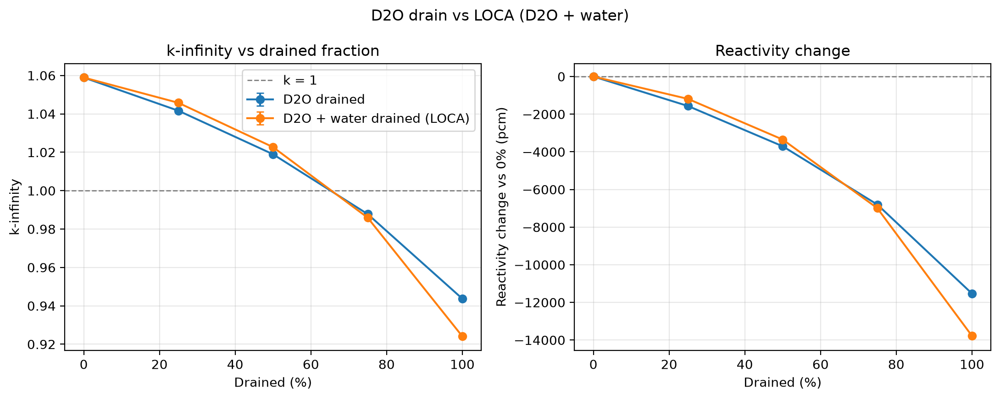
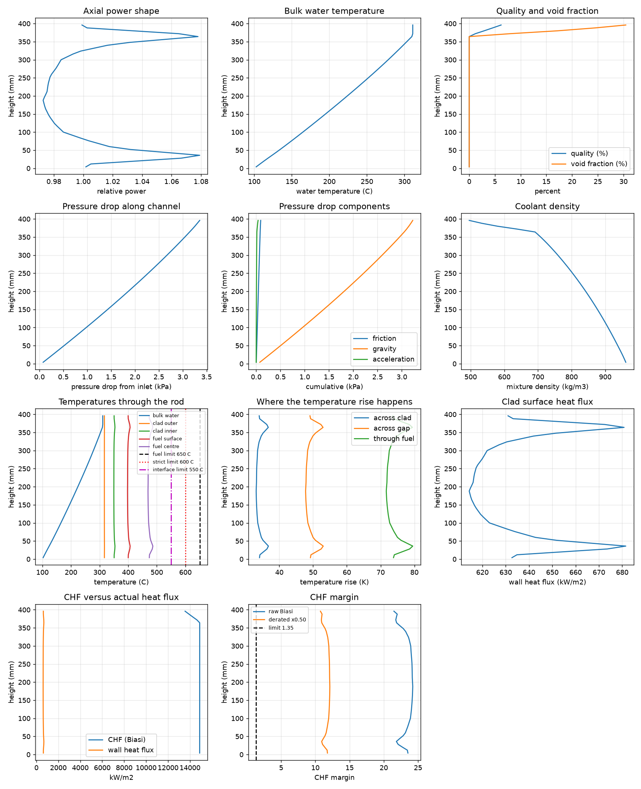
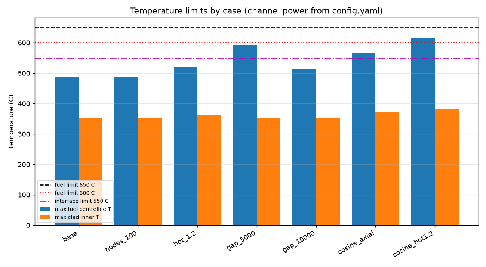

# Computational Synthesis of a Next Generation Reactor Core Architecture

Student research project exploring a conceptual natural-uranium reactor core that combines nuclear-grade graphite and heavy-water moderation with light-water cooling.

## Author

Adarsh Hazra — 10th-grade student and nuclear-engineering enthusiast.

## Acknowledgment

I would like to thank Md Sifath for converting my reactor blueprints into STEP CAD geometry. After I shared the drawings and explained how the design was intended to fit together, he used his CAD skills to create the 3D model files. His work helped carry the project from paper sketches into CAD geometry for the later modelling work. Read the [full acknowledgment](docs/acknowledgments.md).

## Project overview

The study explores whether a graphite-moderated core with a smaller heavy-water inventory could support a natural-uranium fuel cycle. It examines neutronics, heavy-water removal, coolant voiding, loss-of-coolant cases, and a one-dimensional thermal-hydraulics model for a fuel channel.

The work began with paper sketches and STEP CAD geometry. The geometry was converted through a meshing and DAGMC workflow for OpenMC simulations. Neutronics results supplied an axial power distribution to the thermal-hydraulics model. This coupling is one-way: thermal results are not fed back into OpenMC.

## Selected results reported in the study

- A reflected single-block neutronics model gave `k-infinity = 1.05892 ± 0.00053`. Applying the project's assumed 3% leakage correction gives an estimated `k-effective ≈ 1.027`. This is the project's screening estimate, not a full-core calculation or a calculated leakage result.
- In the modeled heavy-water drain cases, `k-infinity` decreased to `0.94371 ± 0.00046` at full drain. This indicates a reactivity reduction in the model; it does not demonstrate a practical passive shutdown system.
- At 20% coolant void, the reported reactivity change was positive for both simplified single-cell models: `+379 ± 91 pcm` for the proposed design and `+173 ± 75 pcm` for the RBMK-type reference cell. These results do not establish full-core feedback behavior.
- For the thermal-hydraulics base case (10 MPa and 0.2 MW per channel), the one-dimensional model reported a peak fuel-centre temperature of about 487 °C and a peak inner-cladding temperature of about 354 °C. These are estimates under assumed inputs, not validated reactor performance predictions.

See [the neutronics results](neutronics/results/tables/) and [the thermal-hydraulics results](thermal_hydraulics/results/tables/) for saved tables. The RBMK-type model is a simplified reference comparison; its complete workflow and raw run outputs are not included in this repository.

## Figures







## Repository contents

```text
neutronics/            OpenMC model source, workflows, saved result tables, and figures
thermal_hydraulics/    One-dimensional channel model, configuration, results, and figures
development/           Development history, version source files, and historical STEP geometry
docs/                  Methods, assumptions, benchmark scope, and reproducibility notes
requirements/          Python package lists for the neutronics and thermal-hydraulics workflows
archive/               Curated development material
```

The development progression is summarized in [the development history](development/DEVELOPMENT_HISTORY.md).

## Reproducibility and limitations

The repository preserves source code, STEP geometry, compact result tables, and selected figures. It does not include the generated DAGMC `.h5m` geometry, raw OpenMC statepoints, tallies, or run folders. The original material-assignment and conversion commands were not fully preserved, so the exact DAGMC geometry cannot be rebuilt from this repository alone. The thermal-hydraulics orchestration scripts expect input paths that differ from the repository's current folder layout and require path adjustments to run. The RBMK comparison workflow and its raw outputs are not included.

This is an exploratory conceptual study, not a validated reactor design, safety analysis, engineering specification, or full-core calculation. The 3% leakage value is an assumption. Thermal-hydraulics results depend on the stated model and assumed inputs. Nothing in this repository should be used for reactor design, licensing, construction, or operation.

See the [report readiness notes](docs/report-readiness.md), [reproducibility guide](docs/reproducibility.md), [neutronics benchmark scope](docs/neutronics-benchmark.md), [assumptions and limitations](docs/assumptions-and-limitations.md), and [publication scope](docs/publication-scope.md) for details.
